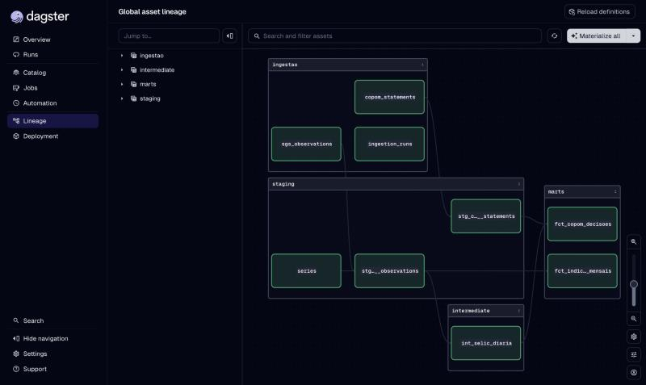

# BCB Data Pipeline — dados do Banco Central para análise e RAG

[](https://github.com/giuliagarbelini26296/bcb-data-pipeline/actions/workflows/ci.yml)

Pipeline de dados ponta a ponta sobre juros e inflação no Brasil:

- **coleta** as APIs públicas do Banco Central (Selic, IPCA, dólar e os comunicados do Copom desde 2000);
- **transforma e testa** os dados com dbt em camadas;
- **orquestra** tudo com Dagster;
- **entrega** a camada final como base de conhecimento de um assistente de IA com RAG ([personal-ai-assistant-rag-mcp](https://github.com/giuliagarbelini26296/personal-ai-assistant-rag-mcp)).

Projeto de estudo de engenharia de dados, criado com apoio de IA. Cada etapa tem um documento em [`docs/estudo/`](docs/estudo) com os conceitos, os problemas reais encontrados, exercícios e perguntas de entrevista.



## Arquitetura

```
APIs do Banco Central                 Postgres (pgvector)
(SGS + comunicados do Copom)
        │
        ▼  Python: incremental e idempotente
   raw / bronze ── sgs_observations, copom_statements, ingestion_runs
        │
        ▼  dbt: views, testes, macros
   staging / silver ── stg_sgs__observations, stg_copom__statements, series (seed)
        │
        ▼  dbt: tabelas, incremental, contrato
   marts / gold ── fct_indicadores_mensais, fct_copom_decisoes, rag_documentos
        │
        ▼  Python: só o que mudou
   arquivos .md ──► embeddings no pgvector ──► assistente responde com fonte

Dagster orquestra tudo: agenda em dias úteis às 19h, retries, checks e alerta de falha.
```

## O que o projeto demonstra

| Tema | Onde |
|---|---|
| Ingestão **incremental** (marca d'água + margem para revisões) e **idempotente** (upsert) | [`ingest.py`](src/bcb_pipeline/ingest.py) |
| API instável: retries com backoff, janelas de 10 anos, falha isolada por fonte, log de execuções | [`bcb_client.py`](src/bcb_pipeline/bcb_client.py) |
| **dbt** em camadas (staging, intermediate, marts), macros, seed, modelo **incremental** e **contrato** de dados | [`dbt_project/`](dbt_project) |
| **Qualidade de dados**: 31 testes de dados e 1 teste de unidade do dbt, incluindo **reconciliação** entre fontes, completude e freshness | [`_staging.yml`](dbt_project/models/staging/_staging.yml), [`tests/`](dbt_project/tests) |
| **Orquestração** com Dagster: assets, linhagem, checks, agenda, retry policy e sensor de falha | [`orchestration.py`](src/bcb_pipeline/orchestration.py) |
| Dados para **RAG**: documentos gerados no dbt, índice vetorial incremental e avaliação da busca | [`rag_documentos.sql`](dbt_project/models/marts/rag_documentos.sql), [`rag.py`](src/bcb_pipeline/rag.py) |
| **CI**: testes, ingestão real, `dbt build`, indexação e portão de qualidade da busca; roda também toda semana | [`ci.yml`](.github/workflows/ci.yml) |

## Resultados (21/11/2026)

- **Carga completa:** 17.473 observações e 237 comunicados em 3,4 min; a carga incremental leva 2 s.
- **Pipeline completo** (ingestão, dbt, documentos e índice): 23 s; a segunda execução leva 17 s e reindexa 0 documentos.
- **Reconciliação:** 192 de 192 taxas escritas nos comunicados batem com a série oficial da Selic. O IPCA de 12 meses recalculado bate com o oficial em 311 meses, com diferença máxima de 0,01 p.p.
- **Busca do RAG** (12 perguntas de referência): hit@1 subiu de **0,40 para 0,80** com duas correções medidas separadamente (ver abaixo).

## O que os testes e as medições encontraram

Os achados mais úteis do projeto. Nenhum aparecia olhando só o caminho feliz:

1. **A API devolve duplicatas.** Nas séries mensais, uma janela de consulta devolve também o mês que "encosta" no início dela.
2. **Feriados.** A nova Selic vale no próximo **dia útil**. A reconciliação falhou em reuniões com Corpus Christi, Tiradentes e 7 de Setembro no meio.
3. **Regex capturando a variação, não a taxa** ("em 0,25 p.p."), e **entidades HTML numéricas** (`&#160;`) que a limpeza não tratava. O dbt bloqueou as camadas seguintes em vez de publicar texto sujo.
4. **Retries e alertas:** o backoff exponencial do Dagster é `delay × (2ⁿ − 1)`, e **sensores começam desligados**. O alerta de falha só funcionou depois de testar o caminho de falha de verdade.
5. **Busca vetorial em documentos parecidos:** os 237 comunicados usam o mesmo vocabulário, e a data, que diferencia um do outro, não chegava ao embedding.

| Configuração da busca | hit@1 | hit@4 | MRR |
|---|---|---|---|
| Original | 0,40 | 0,60 | 0,48 |
| + data por extenso no texto | 0,50 | 0,80 | 0,63 |
| + título do documento em cada pedaço (*contextual chunk header*) | **0,80** | **0,90** | **0,85** |

6. **Cota do Gemini:** o plano gratuito permite 1.000 embeddings por dia, e o corpus tem 1.036 pedaços. Por isso o embedder padrão é local (sem custo e sem limite), e o Gemini é opcional.

## Stack

Python 3.12 · httpx · PostgreSQL 17 + pgvector · dbt-core + dbt-postgres · Dagster + dagster-dbt · pytest · ruff · GitHub Actions · Docker Compose

## Como rodar

```bash
docker compose -p bcb-pipeline up -d                  # Postgres em 127.0.0.1:55434
python -m venv .venv && source .venv/bin/activate
pip install -e ".[dev]"
export DAGSTER_HOME=$PWD/.dagster_home && mkdir -p $DAGSTER_HOME

python -m bcb_pipeline ingest                          # 1. coleta (incremental)
dbt build --project-dir dbt_project --profiles-dir dbt_project     # 2. modelos + testes
dagster dev -m bcb_pipeline.orchestration -p 3070      # 3. interface: http://127.0.0.1:3070
pytest                                                 # 21 testes (banco bcb_test separado)
```

Para gerar o índice do RAG, clone o [assistente](https://github.com/giuliagarbelini26296/personal-ai-assistant-rag-mcp) na pasta ao lado (ou aponte `ASSISTANT_DIR`) e materialize os assets `rag/*`. Para usar embeddings do Gemini: `RAG_EMBEDDING_PROVIDER=gemini` e `GEMINI_API_KEY`.

## Estrutura

```
src/bcb_pipeline/      ingestão, orquestração (Dagster) e exportação para o RAG
dbt_project/           modelos, testes, macros e seed do dbt
tests/                 pytest: cliente da API, ingestão, orquestração e RAG
eval/                  perguntas de referência e relatório da avaliação da busca
docs/estudo/           um documento por etapa
```

## Documentos de estudo

1. [Ingestão incremental e idempotente](docs/estudo/01-ingestao-incremental.md)
2. [dbt e qualidade de dados](docs/estudo/02-dbt-e-qualidade-de-dados.md)
3. [Orquestração com Dagster](docs/estudo/03-orquestracao-dagster.md)
4. [Dados para o RAG](docs/estudo/04-dados-para-o-rag.md)

## Limitações e próximos passos

- Perguntas que comparam reuniões ("quando o BC **começou** a cortar?") pedem SQL, não busca por similaridade. O próximo passo é dar ao agente uma ferramenta de consulta estruturada sobre `fct_copom_decisoes`.
- Roda localmente com Docker. Em nuvem, o caminho natural seria Postgres gerenciado e Dagster+ ou um container agendado.
- Os comunicados mais antigos têm pouco texto (a reunião 51 está vazia no próprio site do BC, por isso ficou como aviso no teste).

Fonte dos dados: [Banco Central do Brasil](https://www.bcb.gov.br/) (SGS e comunicados do Copom), dados públicos.

## Licença

MIT
