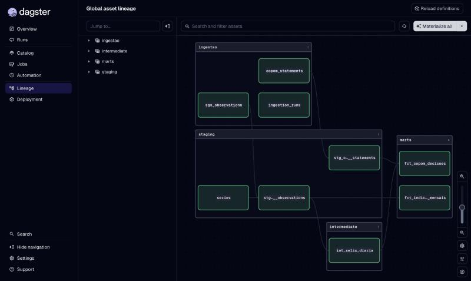

# Etapa 3 — Orquestração com Dagster

As etapas 1 e 2 funcionam quando alguém roda os comandos à mão. Um pipeline de verdade roda **sozinho**, na **ordem certa**, **repete** o que falhou por instabilidade, **avisa** quando quebra e mostra **de onde veio cada tabela**. Esse é o trabalho do orquestrador.



## Por que Dagster (e o que é o Airflow)

| | Airflow | Dagster |
|---|---|---|
| Unidade principal | **tarefa** ("rode este script") | **asset** ("esta tabela precisa existir e estar atualizada") |
| Linhagem | você desenha as dependências entre tarefas | sai das dependências entre os dados |
| dbt | roda como uma tarefa só | cada modelo vira um asset e cada teste vira um check |
| Testar localmente | difícil (precisa de scheduler e banco) | `materialize()` no pytest, com resources falsos |

Os conceitos são os mesmos nos dois: grafo de dependências, agendamento, retries, sensores e alertas. Quem sabe um aprende o outro rápido. O Airflow é o mais comum em vagas; o Dagster é mais moderno e combina melhor com o dbt.

## Conceitos usados

| Conceito | Neste projeto |
|---|---|
| **Asset** | 3 tabelas raw (Python) + 6 do dbt (seed, staging, intermediate, marts) |
| **Linhagem** | as chaves `raw/sgs_observations` dos assets em Python são as mesmas das `sources` do dbt; por isso o grafo liga a ingestão aos modelos |
| **Asset check** | os 28 testes do dbt viram checks; mais um em Python, `series_em_dia` |
| **Resource** | `db` (Postgres), `bcb` (cliente da API), `dbt`; nos testes, o `bcb` é um cliente falso |
| **Job** | `pipeline_diario`: ingestão e depois `dbt build` |
| **Schedule** | dias úteis às 19h, horário de Brasília (`0 19 * * 1-5`) |
| **RetryPolicy** | ingestão repete até 3 vezes, com backoff exponencial: esperas de 30 s, 90 s e 210 s |
| **Sensor** | `alerta_de_falha`: toda execução que falha vira uma linha em `logs/alerts.jsonl` (em produção, Slack ou e-mail). Ligado por padrão no código |

### Freshness: o check que o dbt não faz
A ingestão pode terminar com **sucesso** e o dado mesmo assim estar velho: a API respondeu, só que sem nada novo, porque a fonte parou de publicar. O check `series_em_dia` olha a **data do último valor** de cada série: até 5 dias para as diárias (fim de semana e feriado) e até 75 para as mensais (o IPCA sai por volta do dia 10 do mês seguinte). O teste simula o dólar parado há 20 dias e confere que o check acusa.

## Resultados reais (21/11/2026)

- **Execução completa** (ingestão incremental, 6 modelos dbt e 29 checks): **22 s**. Todos os checks passaram, menos o aviso conhecido da reunião 51.
- **Execução com o banco fora do ar:** 4 tentativas (a original e 3 retries), com esperas de 30 s e 90 s confirmadas no log. Depois da última, a execução falhou após **5,6 min**, e o `dbt build` não rodou.
- **17 testes em pytest**, sem internet: definições, linhagem, testes do dbt como checks, asset de ingestão com cliente falso e o check de atualização.

## Problemas reais desta etapa

1. **`from __future__ import annotations` quebra o Dagster.** Essa linha transforma as anotações de tipo em texto, e o Dagster precisa delas em tempo de execução para reconhecer o `context` e os resources. Erro: *"context must be annotated with AssetExecutionContext"*, mesmo com a anotação certa.
2. **`dbt` fora do PATH.** Sem o ambiente virtual ativado, o Dagster não achava o `dbt`. Corrigido apontando para o `dbt` instalado junto com o Python em uso. O `dagster dev` também roda um `dbt parse` por conta própria, então a pasta do ambiente virtual também foi para o PATH.
3. **Backoff diferente do que eu esperava.** Eu supus esperas de 30, 60 e 120 s. O log mostrou 30 e 90 s: o Dagster calcula `delay × (2ⁿ − 1)`, ou seja, 30, 90 e 210 s. Com 3 tentativas, um problema demora quase 6 minutos para virar alerta. É uma troca: mais paciência com instabilidade, aviso mais lento.
4. **O alerta não disparou (duas causas).** O job falhou e nenhum alerta foi gravado:
   - **sensores começam desligados** no Dagster; agora o código liga o sensor (`default_status=RUNNING`);
   - mesmo ligado, ele ignorou as execuções feitas pelo terminal (`dagster job execute`): elas não carregam a origem do *code location* que o sensor monitora. Uma execução disparada pela interface (com o Postgres parado de propósito) falhou, e o alerta foi gravado em `logs/alerts.jsonl` cerca de 30 s depois.

   Lição: teste o caminho de falha do jeito que ele acontece em produção (pelo daemon e pela agenda), não só o caminho de sucesso.
5. **Uma tabela sem consumidor.** No grafo, `ingestion_runs` não liga a nenhum modelo: só a freshness do dbt a usa. A visualização deixa isso evidente; na etapa 4, ela pode alimentar um painel de saúde do pipeline.

## Como rodar

```bash
export DAGSTER_HOME=$PWD/.dagster_home PYTHONPATH=src
dagster dev -m bcb_pipeline.orchestration -p 3070       # interface em http://127.0.0.1:3070
dagster job execute -m bcb_pipeline.orchestration -j pipeline_diario   # uma execução, sem interface
```

O `dagster dev` também liga o **daemon**, que dispara a agenda e os sensores.

## Exercícios
1. Na interface, clique em `fct_copom_decisoes` e abra a aba **Checks**. Qual teste do dbt protege a decisão do Copom?
2. Mude a agenda para rodar também aos sábados. Qual é o cron?
3. Coloque `max_retries=0` na ingestão e rode com o banco fora do ar. O que muda no tempo até o alerta?
4. Desafio: crie um asset `saude_do_pipeline` que lê `raw.ingestion_runs` e calcula a taxa de sucesso dos últimos 30 dias.

## Perguntas de entrevista
- **O que um orquestrador faz que um cron não faz?** Ordem por dependência, retries, histórico de execuções, linhagem, reprocessamento de uma parte só, alertas e uma interface para ver o estado de cada dado.
- **Asset ou tarefa?** Tarefa diz o que **executar**; asset diz o que precisa **existir**. Com assets, o orquestrador sabe o que está desatualizado e o que depende de quê.
- **Quando usar retry, e quando não?** Para falha temporária (rede, 429, banco reiniciando). Erro de dado ou de lógica não melhora com retry: tem que falhar rápido e avisar.
- **Como saber se o dado está atualizado, e não só se o job rodou?** Check de freshness na data do **dado**, não na data da execução.
- **Como testar um pipeline?** Testes de unidade das funções, resources falsos para as fontes externas, um banco de teste separado e checks de dados a cada execução.
